

<a href="https://jovialjoyson.vercel.app">
  
</a>

  

 

## About me

I'm an **EEE undergraduate at Christ College of Engineering, Irinjalakuda** (B.Tech, expected 2027) working where
power hardware meets embedded control: **power electronics, renewable energy, electric vehicles, embedded systems
and industrial automation**.

- Built **Battery Management System** work for an **eBAJA EV** prototype
- **IEEE Smart Village intern** with SunMoksha Power: solar PV microgrids and rural electrification in Jharkhand
- **Project intern at NITK Surathkal** on a funded project: EMG signal processing and FES control in MATLAB/Simulink
- Co-author of an **Indian patent application** on context-aware monitoring of electrical motors
- **Winner & Best Pitch**, BeachHack H4C

 

## Featured work

<table>
  <tr>
    <td width="50%"><a href="https://jovialjoyson.vercel.app/#patent">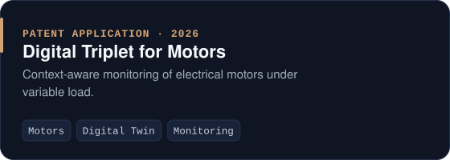</a></td>
    <td width="50%"><a href="https://jovialjoyson.vercel.app/project/ebaja-ev-competition-9747">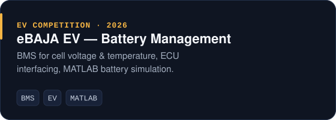</a></td>
  </tr>
  <tr>
    <td width="50%"><a href="https://jovialjoyson.vercel.app/project/animal-deterrent-system-9834">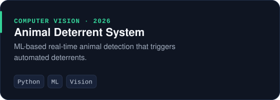</a></td>
    <td width="50%"><a href="https://jovialjoyson.vercel.app/project/meditask-tele-rehabilitation-platform-9889">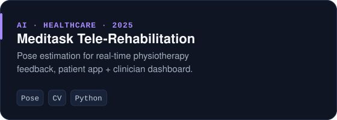</a></td>
  </tr>
  <tr>
    <td width="50%"><a href="https://jovialjoyson.vercel.app/project/wireless-robotic-arm-9947">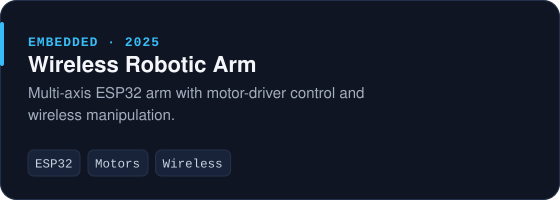</a></td>
    <td width="50%"><a href="https://jovialjoyson.vercel.app/project/smart-home-automation-0001">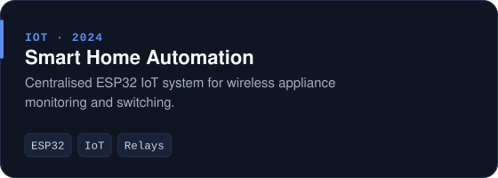</a></td>
  </tr>
</table>

<b>From the build bench</b>

 
<table>
  <tr>
    <td width="50%" align="center">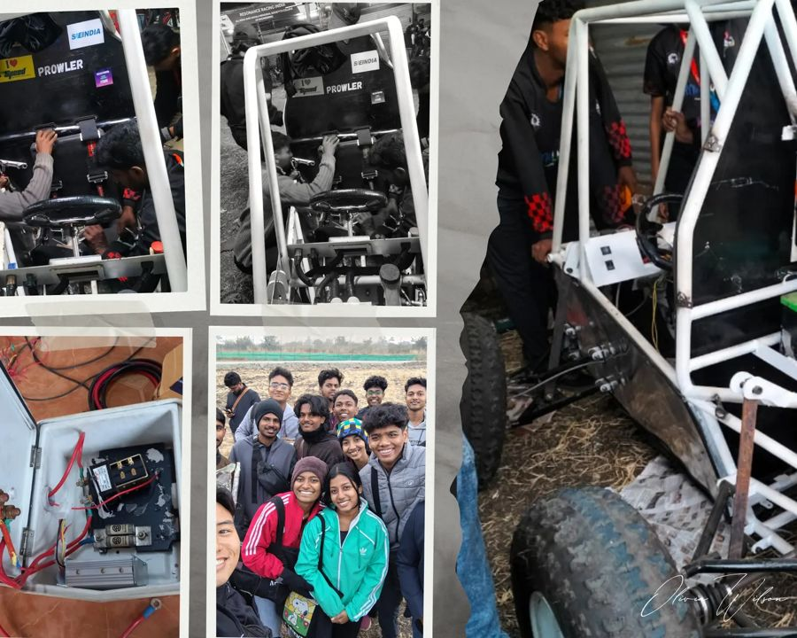 <b>eBAJA EV build</b></td>
    <td width="50%" align="center">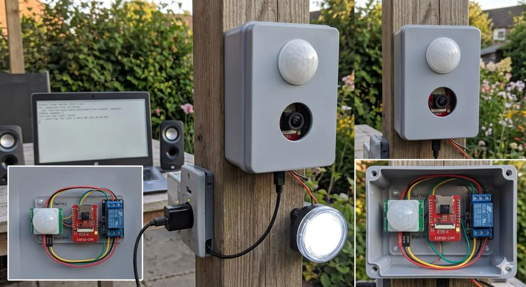 <b>Animal deterrent prototype</b></td>
  </tr>
  <tr>
    <td width="50%" align="center">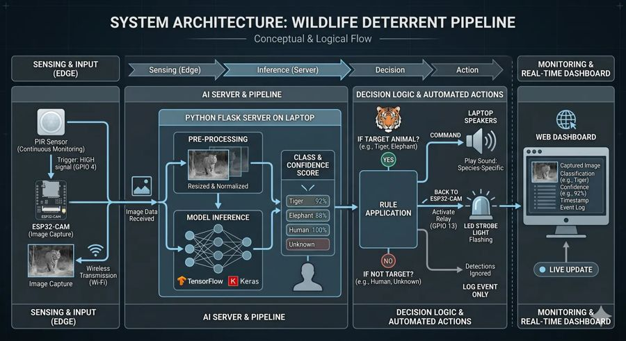 <b>Deterrent system architecture</b></td>
    <td width="50%" align="center">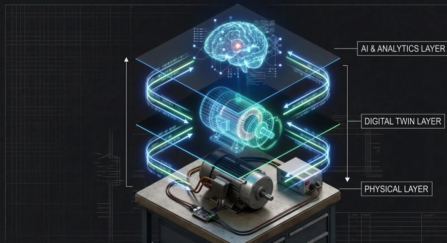 <b>Digital triplet concept</b></td>
  </tr>
</table>

 

## Experience

| Role | Organisation | When |
|---|---|---|
| **IEEE Smart Village Intern** — solar PV microgrids, rural electrification, FPO business models | SunMoksha Power Pvt. Ltd. · Kantashola MEZ, Jharkhand | Jul – Aug 2026 |
| **Project Intern (Funded Project)** — EMG biosignals, FES system models & control | NITK Surathkal | Jun 2026 |
| **Client Management Intern** — requirements & technical documentation | White Matrix Software Solutions | Jan 2026 – Present |

 

## Toolbox

  
  
  
  
  
  

  
  
  
  
  

  
  
  
  

 

## Recognition

<table>
  <tr>
    <td valign="top" width="33%">
      <b>Awards</b>  
      Winner &amp; Best Pitch, BeachHack H4C 
      1st Place, Pitch Perfect Idea 
      Finalist, BeachHack AI
    </td>
    <td valign="top" width="33%">
      <b>Certifications</b>  
      IIT Madras Pravartak: Intelligent Data Center O&amp;M 
      NPTEL: Introduction to Machine Learning 
      Siemens CoE: PLC, SCADA, HMI &amp; Industrial Automation
    </td>
    <td valign="top" width="33%">
      <b>Leadership</b>  
      Chair, IEEE IAS 
      Technical Head, BETA (EEE Dept.) 
      Communication Head, Meta Hub
    </td>
  </tr>
</table>

 

## Currently exploring

`EV battery systems` · `Intelligent motor monitoring` · `Predictive maintenance` · `Industrial IoT` · `Embedded AI`

 

  Open to internships and research collaborations in power electronics, EVs, renewable energy and embedded control. 
  Irinjalakuda, Kerala, India

